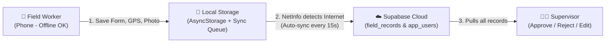
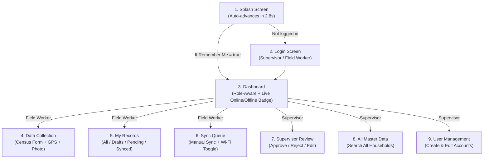
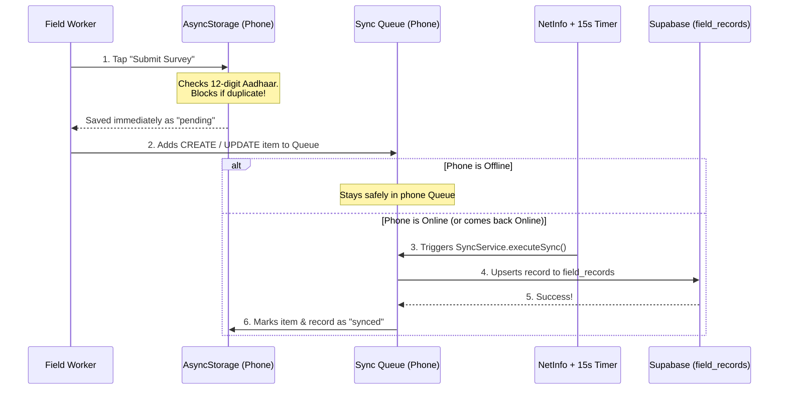
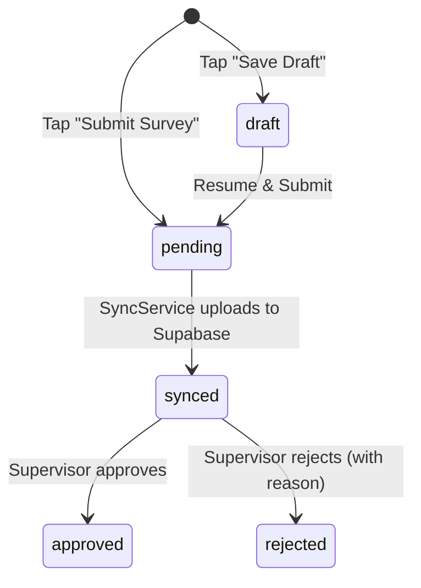
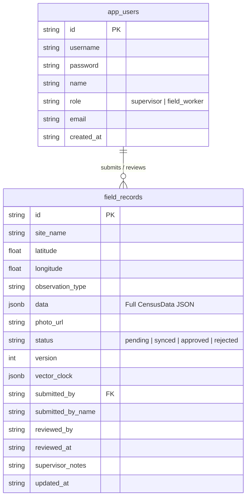
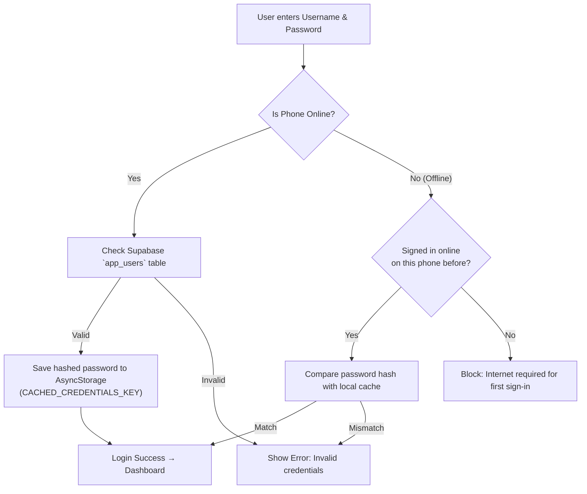

# OFFDP — Team Presentation Guide (3-Person Split)

**Project:** Offline-First Field Data Platform (Digital Census 2026)  
**Package:** `com.offdp.app` (`v1.0.0`)  
**Tech Stack:** React Native (`0.88.1`), Expo (`~58.0.22`), TypeScript, AsyncStorage, NetInfo, Supabase  

---

## 🎯 30-Second Elevator Pitch (Anyone Can Say This First)

> *"OFFDP is an Android mobile app built for Digital Census 2026. Normally, government or field surveys fail in rural areas because there is no internet. Our app solves this with an **Offline-First** design: field workers can log in, capture GPS, photos, and full household forms completely offline. Everything saves instantly on the phone, and as soon as internet returns, it automatically syncs to the Supabase cloud where Supervisors can review, approve, or reject records."*

---

## 👥 How to Split the Presentation

| Speaker | Topic | Key Files to Mention |
|---|---|---|
| **Person 1** | **Frontend & Mobile UI** | `App.tsx`, `src/screens/*`, `src/components/*` |
| **Person 2** | **Offline Storage & Sync Engine** | `src/services/storageService.ts`, `src/services/syncService.ts` |
| **Person 3** | **Backend, Cloud DB & Authentication** | `src/services/supabaseClient.ts`, `src/services/authService.ts` |

---

# 1️⃣ Person 1: Frontend & Mobile UI

### What is your part?
You are explaining **everything the user sees and touches** on the phone—the screens, navigation, camera, GPS, and role-based dashboards.

### 🛠️ What We Used & Why

| Technology / Library | What It Does | Why We Used It |
|---|---|---|
| **React Native (`0.88.1`) + TypeScript** | Builds native Android UI using JavaScript/TypeScript components. | One codebase, fast UI updates, and strong type safety (`src/types/index.ts`). |
| **Expo (`~58.0.22`)** | Framework & build tool (`eas.json`) to compile the `.apk`. | Lets us build an installable Android APK in the cloud without complex native Android setup. |
| **`expo-location`** | Reads the phone's GPS latitude, longitude, and accuracy. | Proves *where* each census household was surveyed. |
| **`expo-image-picker`** | Opens the camera or gallery to attach a household photo. | Captures visual proof of the household/site. |
| **`expo-linear-gradient` & `@expo/vector-icons`** | Renders purple gradients (`#27124f` → `#542699`) and icons. | Gives the app a clean, modern, readable mobile interface. |
| **Custom State Navigation (`App.tsx`)** | Switches screens using `currentScreen` state + `NavigationDrawer` + Android `BackHandler`. | Simple, fast switching between 9 screens and handles the Android hardware back button cleanly. |

### 🗺️ Screen Flow Visual

### 📱 What Happens on the Main Screens
1. **Header & Online/Offline Badge (`HeaderBar.tsx`)**: Every main screen shows a live **Online / Offline** badge so the worker always knows if they have internet.
2. **Data Collection (`DataCollectionScreen.tsx`)**:
   - Captures **GPS coordinates** and a **Photo**.
   - Collects **Digital Census 2026** fields: Head of Family, 12-digit Aadhaar UID, Phone, Gender, Age, Total Members, Social Category, House Type, Ownership, 8 Amenities (Electricity, Piped Water, Toilet, LPG, Ration Card, Internet, Solar, Bank Account), Occupation, and Income Bracket.
   - Has two buttons: **Save Draft** (finish later) or **Submit Survey** (lock in and queue for sync).
3. **Role-Based UI**: The same app adapts automatically—**Field Workers** see *Data Collection, My Records, Sync Queue*, while **Supervisors** see *Supervisor Review, All Master Data, User Management*.

### 🎤 Easy Script for Person 1
> *"Hi, I'm explaining the Frontend of OFFDP. We built it using React Native and Expo, which compiles directly into an Android APK. When you open the app, you see our Splash screen and Login screen. Based on whether you log in as a Field Worker or a Supervisor, the Dashboard and sliding Hamburger Menu change automatically. For Field Workers, the Data Collection screen uses `expo-location` for GPS and `expo-image-picker` for photos, alongside the full Digital Census 2026 form. Workers can save incomplete forms as Drafts or submit them, and track everything in My Records."*

### ❓ Common Questions Person 1 Might Get
- **Q: Why use Expo instead of pure Android Studio (Java/Kotlin)?**  
  *A: Expo lets us write in TypeScript/React Native and build a standalone `.apk` easily using EAS (`eas.json`), while still accessing native phone hardware like GPS and Camera.*
- **Q: What happens if the user presses the Android Back button?**  
  *A: We handled `BackHandler` in `App.tsx`—it closes the drawer if open, returns sub-screens to the Dashboard, and asks for confirmation before exiting the app.*

---

# 2️⃣ Person 2: Offline Storage & Sync Engine

### What is your part?
You are explaining **the core innovation of the project**: how the app works with zero internet, prevents duplicate entries, and syncs safely when internet comes back.

### 🛠️ What We Used & Why

| Technology / Library | What It Does | Why We Used It |
|---|---|---|
| **`@react-native-async-storage/async-storage`** | Stores JSON data (records, sync queue, settings, cached users) directly on the phone's storage. | Reads and writes are instant and **never block on the network**. |
| **`@react-native-community/netinfo`** | Listens to the phone's Wi-Fi / mobile data connection in real time. | Updates the Online/Offline badge and automatically triggers sync when internet returns. |
| **Custom `SyncService` (`syncService.ts`)** | Processes the Sync Queue one item at a time and upserts to Supabase. | Handles retries, tracks failures (`retryCount`, `errorReason`), and prevents duplicate sync runs. |

### 🔄 How Offline-to-Online Sync Works (Visual)

### 📊 Record Status Lifecycle

### 🧠 4 Smart Features in the Sync Engine
1. **Aadhaar De-duplication (`normalizeAadhar` in `storageService.ts`)**: Strips spaces/dashes from the 12-digit Aadhaar number and checks local records before saving—so two workers or forms can't register the same household twice.
2. **Auto-Sync + 15-Second Interval (`App.tsx`)**: Syncs automatically the moment `NetInfo` detects internet, AND runs a background check every **15 seconds** while online.
3. **Wi-Fi Only & Background Sync Toggles (`SyncQueueScreen.tsx`)**: Field workers can pause background sync or restrict syncing to Wi-Fi only to save mobile data.
4. **Version & Vector Clock (`version`, `vectorClock`)**: Every edit increments a `version` number and a per-user `vectorClock` counter so edits by workers and supervisors are tracked cleanly.

### 🎤 Easy Script for Person 2
> *"Hi, I'm explaining the Offline Storage and Sync Engine—the heart of OFFDP. Whenever a worker taps Submit, the app never waits for the internet. First, `StorageService` normalizes the 12-digit Aadhaar number to block duplicates, then saves the record instantly to `AsyncStorage` on the phone with status `pending`, and adds a `CREATE` or `UPDATE` job to our persistent Sync Queue. Meanwhile, `NetInfo` watches the phone's internet connection. As soon as the device is online—and every 15 seconds while online—`SyncService` pushes queued items to Supabase and updates their status to `synced`. If the user turns on 'Wi-Fi Only' in the Sync Queue screen, it waits for Wi-Fi."*

### ❓ Common Questions Person 2 Might Get
- **Q: What happens if the internet cuts out halfway during a sync?**  
  *A: `SyncService` catches the error, marks that queue item as `failed`, increments `retryCount`, saves the `errorReason`, and automatically retries it on the next sync cycle.*
- **Q: What if the worker saves a Draft? Does that sync?**  
  *A: No, `draft` records stay only on the phone (`AsyncStorage`) until the worker finishes and taps Submit.*

---

# 3️⃣ Person 3: Backend, Cloud Database & Authentication

### What is your part?
You are explaining **where the data lives in the cloud (Supabase)**, how **Login works both online and offline**, and how **Supervisors** manage data and users.

### 🛠️ What We Used & Why

| Technology / Service | What It Does | Why We Used It |
|---|---|---|
| **Supabase (`@supabase/supabase-js`)** | Managed PostgreSQL cloud database with REST APIs. | Free, fast, SQL-backed, and works directly from React Native without writing a separate Node/Express server. |
| **Two Cloud Tables** | `field_records` (census surveys) and `app_users` (user accounts). | Clean separation between survey data and user/role management. |
| **Offline Credential Cache (`authService.ts`)** | Stores a hashed password (`hashCredential`) in `AsyncStorage` after first online login. | Lets workers log in even in remote areas with no internet, while keeping first-time login secure. |

### 🗄️ Cloud Database Structure (Supabase)

### 🔐 How Online & Offline Login Works

### 🧑‍💼 Supervisor Capabilities (Backend + Role Control)
1. **Data Isolation**: When pulling from Supabase (`StorageService.getRecords`), **Field Workers** only download records where `submitted_by == user.id`. **Supervisors** download *all* records across all workers.
2. **Supervisor Review (`SupervisorReviewScreen.tsx`)**: Supervisors can **Approve**, **Reject** (with a required reason), or **Edit** any household record inline and add `supervisorNotes`.
3. **User Management (`UserManagementScreen.tsx`)**: Supervisors can create, edit, or delete Field Worker & Supervisor accounts (requires internet so `app_users` in Supabase stays the single source of truth). The default supervisor account (`narayan` / `admin`) is protected from deletion.

### 🎤 Easy Script for Person 3
> *"Hi, I'm explaining the Backend, Database, and Authentication. We use Supabase—a PostgreSQL cloud database—connected via `@supabase/supabase-js` in `supabaseClient.ts`. We have two main tables: `app_users` for accounts and roles, and `field_records` for all census surveys, GPS coordinates, and supervisor reviews. For security, a user's first login on a device requires internet to verify against Supabase; once verified, `AuthService` caches a hashed version of their password locally so they can log in offline in the field. Finally, Supervisors have full access to review, approve, reject, or edit records, and manage Field Worker accounts."*

### ❓ Common Questions Person 3 Might Get
- **Q: Can a Field Worker see another Field Worker's census data?**  
  *A: No. Both in the UI (`App.tsx`) and when pulling from Supabase (`StorageService.getRecords`), Field Workers only see records where `submitted_by` matches their own user ID. Only Supervisors see all records.*
- **Q: Can someone create a new user account while offline?**  
  *A: No, `AuthService.createUser` intentionally blocks offline user creation so usernames stay unique in Supabase `app_users`.*

---

## 🎬 Quick 2-Minute Live Demo Order for Tomorrow

1. **Person 1** opens the app → shows **Splash → Login → Dashboard** → opens **Data Collection**, captures GPS & photo, fills a household, and taps **Save Draft** / **Submit**.
2. **Person 2** turns **Airplane Mode ON** → submits another survey → shows it saved immediately in **My Records** & **Sync Queue** → turns **Airplane Mode OFF** → shows **Auto-Sync** pushing it to **Synced**!
3. **Person 3** logs in as **Supervisor** (`narayan` / `admin`) → opens **Supervisor Review** → **Approves** or **Rejects** the newly synced record → shows **User Management** & explains the **Supabase** tables.
